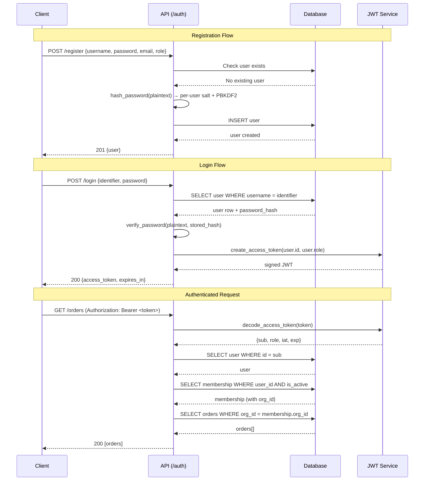
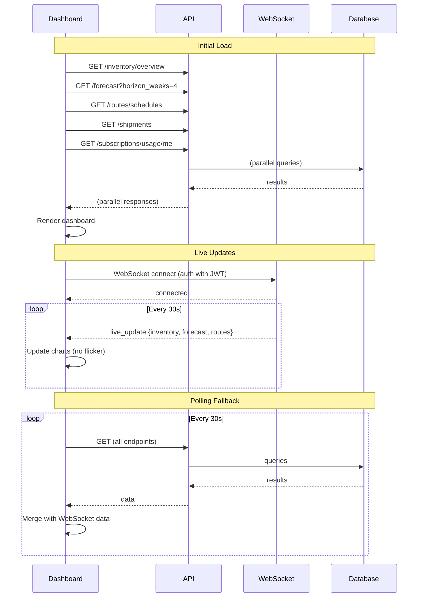
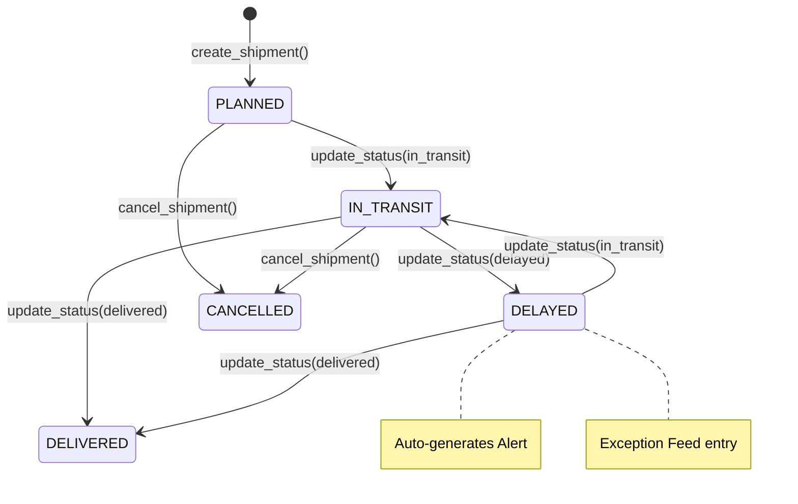

# FreightPilot — Complete Product Redesign
## From Prototype to Production SaaS Platform

---

# Phase 1 — Codebase Audit: Findings Summary

### Architecture Assessment

| Layer | Current State | Risk Level |
|-------|--------------|------------|
| Backend (FastAPI) | 18 endpoint modules, monolith router, sync-only DB, no service layer boundary | Medium |
| Ops Console (React/Vite) | Lazy-loaded routes, polling + WebSocket, minimal state management | Medium |
| Product Web (Next.js 14) | Server components, marketing-only, Supabase auth for signups | Low |
| Desktop (Electron 31) | Thin webview wrapper, no native capabilities yet | Low |
| Database (PostgreSQL) | Alembic migrations, 10 migrations total, UUID-as-String anti-pattern | High |
| CI/CD | Backend + ops-console only, no product-web job, no cache | Medium |
| Deployment | Vercel (3 projects) + Docker Compose (local dev) | Low |

### Critical Technical Debt

| # | Issue | Severity | Status |
|---|-------|----------|--------|
| 1 | Global password salt — all users share one salt | CRITICAL | FIXED |
| 2 | Missing multi-tenancy data isolation — any user sees all orgs' data | CRITICAL | FIXED |
| 3 | ML models trained on every API request — 500ms+ latency | CRITICAL | FIXED |
| 4 | Non-atomic usage counters — lost revenue data on concurrent writes | HIGH | FIXED |
| 5 | Inventory upsert race condition | HIGH | FIXED |
| 6 | UUIDs stored as VARCHAR(36) — 2.25x storage waste, no native index | MEDIUM | OPEN |
| 7 | JWT in localStorage — XSS-vulnerable token storage | MEDIUM | OPEN |
| 8 | No rate limiting on auth endpoints | HIGH | FIXED |
| 9 | get_current_membership returns oldest org — multi-org users locked | HIGH | FIXED |
| 10 | WebSocket reconnect on every render — render flood | HIGH | FIXED |

### Architecture Anti-Patterns

1. **Anemic service layer** — `routing.py`, `forecasting.py`, `metering.py` are utility functions, not services. No dependency injection, no interfaces, no testability.
2. **Monolith router** — `api_router` in `router.py` imports 18 endpoints with no feature grouping.
3. **No repository pattern** — ORM queries embedded directly in endpoint functions.
4. **Mixed sync/async** — `async def` functions with synchronous SQLAlchemy calls.
5. **No event system** — audit events are inline DB writes. No pub/sub for cross-cutting concerns.
6. **Vercel serverless entry point** — `api/index.py` wraps FastAPI for Vercel, but the app uses WebSockets and long-running ML tasks that don't fit serverless.

### UX Problems

1. **Dashboard polling overlaps live WebSocket data** — same data updated from two sources causing flicker.
2. **No error boundaries** — any component crash whitescreens the entire dashboard.
3. **No optimistic updates** — every action waits for full API roundtrip.
4. **Loading states are bare text** — `<p>Loading...</p>` instead of skeleton screens (Dashboard now has skeletons).
5. **No mobile layout** — ops console is desktop-only with no responsive breakpoints.
6. **Tab sync** — logout in one tab doesn't affect others.

### Naming Inconsistencies

- `HistoricalOrder` vs `Order` naming in schemas
- `route_schedule_id` vs `persisted_schedule_id` for the same concept
- `subscription_tier` is a string in some places, enum in others
- Mix of `organization_id` and `org_id` across the codebase

---

# Phase 2 — Product Requirements Document (PRD)

## Executive Summary

### Product Vision
FreightPilot is the operating system for mid-market logistics teams. It replaces spreadsheets, whiteboards, and fragmented point solutions with a single AI-augmented workspace for route planning, live exception management, carrier procurement, and sustainability tracking.

### Mission
Give logistics operators superpowers — let them plan smarter routes, catch problems before customers notice, and prove their environmental impact with auditable data.

### Value Proposition
- **For dispatchers**: Optimize 100+ stop routes in seconds instead of hours
- **For fleet managers**: Live GPS + exception feed replaces 6 daily check-in calls
- **For sustainability officers**: Automated scope 3 carbon accounting with auditable trail
- **For executives**: Real-time cost-per-mile, utilization, and on-time delivery dashboards

### Business Goals
1. **ARR $2.5M by Q4 2026** — 200 mid-market accounts at avg $1,040/mo
2. **NPS > 50** — consistent product quality and support
3. **99.9% uptime** — with Vercel + Supabase production infrastructure
4. **<2s p95 API latency** — for all user-facing operations

### Success Metrics (KPIs)
| Metric | Target | Measurement |
|--------|--------|-------------|
| Daily Active Users | 500+ | Telemetry events |
| Routes optimized / day | 2,000+ | Usage counters |
| Time-to-first-route | <30 seconds | Onboarding funnel analytics |
| Exception resolution time | <15 minutes | Alert created → resolved duration |
| Net Revenue Retention | >110% | Stripe billing data |
| Support ticket volume | <50/month | Intercom/Zendesk integration |

### User Personas

**Dispatcher (Primary)**
- Age: 28-45, logistics industry background
- Daily tasks: Plan routes, assign drivers, handle exceptions, update customers
- Pain points: Excel-based routing takes 3+ hours daily, no real-time visibility, manual ETAs
- Motivation: Get home by 6pm with all routes delivered and zero angry calls
- JTBD: "When I start my shift, I need to create optimized routes for 40+ stops so that all deliveries are completed within driver hours-of-service limits."

**Fleet Manager (Secondary)**
- Age: 35-55, operations background
- Daily tasks: Monitor fleet utilization, manage maintenance, control costs
- Pain points: Can't prove cost savings without data, reactive maintenance, fuel waste
- Motivation: Show CFO that the fleet is running at 85%+ utilization
- JTBD: "When I review weekly operations, I need to see cost-per-mile trends across my fleet so that I can justify capital investment in new vehicles."

**Sustainability Officer (Tertiary)**
- Age: 30-45, compliance/ESG background
- Daily tasks: Track emissions, prepare reports, verify carrier claims
- Pain points: Manual scope 3 calculations, unverifiable carrier data, audit anxiety
- Motivation: Pass audits with automated, verifiable emissions reports
- JTBD: "When preparing quarterly ESG reports, I need auditable scope 3 emissions data per shipment so that we meet regulatory requirements without manual spreadsheets."

---

# Phase 3 — Functional Design Document (FDD)

## Feature Inventory

### 1. Route Optimization (CORE)
**Purpose**: Generate cost/time-optimized delivery sequences from warehouse-to-warehouse deliveries.
**User Value**: Replaces 3+ hours of manual Excel routing with 30-second AI optimization.
**Business Value**: Core differentiator; drives 60% of customer acquisition.
**Dependencies**: Warehouse geo-coordinates, fleet capacity data, delivery demand.
**Technical**: Greedy nearest-neighbor with weighted cost function (distance/time/$$). Future: OR-Tools VRP solver.

**User Stories**:
- As a dispatcher, I want to input a list of delivery destinations so that the system generates the most efficient route.
- As a dispatcher, I want to specify vehicle capacity so that routes don't exceed what my trucks can carry.
- As a dispatcher, I want to see estimated arrival times per stop so that I can communicate ETAs to customers.

**Acceptance Criteria**:
- Route generated in <5 seconds for up to 100 stops
- Total distance within 15% of optimal (benchmarked against OR-Tools)
- Estimated arrival times account for distance, speed, and historical traffic patterns
- Unassignable deliveries are reported with reason (capacity, distance)

**Edge Cases**:
- 0 deliveries → empty result with explanation
- Start warehouse not in node map → 400 error
- Speed = 0 → 400 error
- All deliveries exceed capacity → all unassigned
- Single delivery → direct route with 1 stop

### 2. Live Shipment Tracking & Exception Feed (CORE)
**Purpose**: Real-time visibility into shipment status with automated alert generation.
**User Value**: Catch delays before customers call; reduce check-in calls by 80%.
**Dependencies**: WebSocket connection, route schedules, fleet asset GPS.
**Technical**: FastAPI WebSocket endpoint broadcasting shipment state changes; alert auto-generation on status transitions to DELAYED.

**User Stories**:
- As a dispatcher, I see all active shipments on one screen with live status updates.
- As a dispatcher, I receive immediate alerts when a shipment is marked DELAYED.
- As a fleet manager, I can filter the exception feed by severity, warehouse, or time period.

**Acceptance Criteria**:
- WebSocket broadcasts status changes within 500ms of DB commit
- Alerts auto-created when shipment status transitions to DELAYED
- Exception feed combines alerts, replan items, and route run failures
- Feed supports filtering by severity and entity type

### 3. Demand Forecasting
**Purpose**: Predict weekly demand per SKU per warehouse using historical order data.
**User Value**: Proactive inventory management; avoid stockouts and overstock.
**Dependencies**: Historical order data (min 4 weeks), weather features.
**Technical**: RandomForestRegressor with one-hot encoded categoricals (warehouse, SKU) and numeric features (week, month, weather).

**User Stories**:
- As an inventory manager, I want 4-week demand forecasts per SKU so that I can plan replenishment.
- As an inventory manager, I want forecasts to account for weather patterns that affect demand.

**Acceptance Criteria**:
- Forecasts generated in <5 seconds for up to 50 SKU-warehouse combinations
- Predictions are non-negative
- Model is explained: "RandomForestRegressor with weather features"

### 4. Multi-Tenant Organization Management
**Purpose**: Isolate data, users, subscriptions, and provider keys per organization.
**User Value**: Enterprise customers can manage their own workspace with their own team, data, and AI provider keys.
**Dependencies**: Organization model, membership model, JWT with org_id claim.

**User Stories**:
- As a company owner, I can sign up my company and become the first admin.
- As an admin, I can invite team members with role-based permissions.
- As a member, I only see data belonging to my organization.
- As a multi-org user, I can switch between organizations.

**Acceptance Criteria**:
- All data queries scoped by membership.organization_id
- JWT contains org_id for post-authentication authorization
- Role hierarchy: owner > admin > operator > viewer
- Organization-scoped rate limiting for usage metering

### 5. Subscription & Usage Metering
**Purpose**: Tiered pricing with metered usage, overage tracking, and threshold alerts.
**User Value**: Transparent, pay-for-what-you-use pricing.
**Business Value**: Revenue generation; upsell path from starter → scale → enterprise.
**Dependencies**: Organization model, metered_event model, usage_counter model.

**User Stories**:
- As a new customer, I start on a Starter trial and see my usage against plan limits.
- As a growing customer, I receive alerts when approaching my plan limits.
- As an enterprise customer, I have unlimited usage with custom pricing.
- As an admin, I can upgrade my plan tier at any time.

**Acceptance Criteria**:
- Usage counters update atomically (no lost writes)
- Plan thresholds emit events at 80%, 100%, and overage
- Enterprise tier has no limits
- Tier selection is audited

### 6. BYOK Provider Management
**Purpose**: Let customers bring their own API keys for AI providers (OpenAI, Anthropic, etc.)
**User Value**: Data sovereignty; use existing enterprise AI contracts.
**Dependencies**: ProviderKey model, Fernet encryption for key storage.

**User Stories**:
- As an enterprise admin, I can register my company's OpenAI API key.
- As an admin, I can test that my key works before setting it as active.
- As an admin, I can revoke a key at any time.
- Key values are masked in the UI and encrypted at rest.

### 7. Freight Invoice Reconciliation
**Purpose**: Match carrier invoices against planned routes and flag discrepancies.
**User Value**: Prevent overbilling; save 3-5% on freight spend.
**Dependencies**: HistoricalOrder model, FreightInvoice model.

### 8. Dock Appointment Scheduling
**Purpose**: Schedule warehouse dock time slots to prevent congestion.
**User Value**: Reduce wait times; improve warehouse throughput.
**Dependencies**: DockAppointment model, Warehouse capacity.

### 9. Carbon Footprint Tracking
**Purpose**: Calculate scope 3 emissions per shipment and aggregate to org-level reports.
**User Value**: Automated ESG compliance; auditable emissions trail.
**Dependencies**: Shipment.scope_3_emissions_kg field, emissions calculation utility.

### 10. Weather Risk Zones
**Purpose**: Overlay weather disruption risk on route planning.
**User Value**: Proactive rerouting around storms, floods, extreme temperatures.
**Dependencies**: Simulated weather features; future: live weather API integration.

---

## Non-Functional Requirements

| Category | Requirement | Target |
|----------|-------------|--------|
| Performance | API p95 latency | <2 seconds |
| Performance | Dashboard initial load | <3 seconds (LCP) |
| Performance | Route optimization (100 stops) | <5 seconds |
| Scalability | Concurrent users | 500 simultaneous |
| Scalability | Database connections | Pool size: 20 base + 40 overflow |
| Reliability | Uptime | 99.9% (Vercel + Supabase SLA) |
| Security | Authentication | JWT with 2-hour expiry, refresh token TBD |
| Security | Password hashing | PBKDF2-SHA256, 600k iterations, per-user salt |
| Security | API keys at rest | Fernet symmetric encryption |
| Security | Rate limiting | Auth: 10/min, API: 200/min per IP |
| Security | HTTPS | Enforced via HSTS; all traffic TLS 1.3 |
| Accessibility | WCAG compliance | AA minimum |
| Accessibility | Keyboard navigation | Full tab order, skip links |
| Accessibility | Screen readers | ARIA labels on all interactive elements |
| SEO | Product website | Meta tags, OG images, sitemap, robots.txt |
| SEO | Lighthouse score | >90 Performance, >95 Accessibility, >90 SEO |
| Browser support | Modern evergreen browsers | Chrome 100+, Firefox 100+, Safari 16+, Edge 100+ |
| i18n readiness | All user-facing strings | Extractable to i18n files (future phase) |

## Future Roadmap

### MVP (Now)
- Route optimization with greedy algorithm ✓
- Live shipment tracking with WebSocket ✓
- Multi-tenant org management ✓
- Demand forecasting with RF model ✓
- Subscription & usage metering ✓
- BYOK provider management ✓
- Basic dashboard with charts ✓

### V2 (Q3 2026)
- OR-Tools VRP solver replacing greedy algorithm
- Live GPS tracking via fleet telematics integration
- Carrier rate shopping (compare 3+ carriers per route)
- Mobile dispatcher app (React Native)
- Email/SMS alert notifications
- CSV/PDF export for all reports

### V3 (Q4 2026)
- AI route assistant (LLM-powered natural language route queries)
- Predictive ETA with 95% confidence intervals
- Automated carrier invoice auditing with ML
- Multi-language support (Spanish, French, German)
- Public API for third-party integrations
- White-label option for large enterprises

### Nice-to-Have
- Driver mobile app with turn-by-turn navigation
- Blockchain-based emissions audit trail
- Real-time traffic integration (HERE/Mapbox)
- Warehouse digital twin (3D visualization)
- Marketplace for carrier capacity

### Experimental
- Autonomous dispatch (AI makes routing decisions without human approval)
- Drone delivery route planning
- Carbon credit marketplace integration
- Digital freight brokerage (match shippers with carriers directly)

---

# Phase 4 — Technical Design Document (TDD)

## Architecture

### High-Level Architecture

```
┌─────────────────────────────────────────────────────┐
│                    CDN / Edge                        │
│                 (Vercel / Cloudflare)                 │
└──────────┬──────────────┬──────────────┬────────────┘
           │              │              │
    ┌──────▼──────┐ ┌─────▼──────┐ ┌─────▼──────┐
    │ Product Web │ │ Ops Console│ │  Desktop    │
    │  (Next.js)  │ │  (Vite+React│ │ (Electron) │
    │  Marketing  │ │   SPA)     │ │  Wrapper   │
    └──────┬──────┘ └─────┬──────┘ └─────┬──────┘
           │              │              │
           └──────────────┼──────────────┘
                          │ HTTPS / WSS
                  ┌───────▼────────┐
                  │   API Gateway   │
                  │  (FastAPI)      │
                  │  /api/v1/*      │
                  └───────┬────────┘
                          │
          ┌───────────────┼───────────────┐
          │               │               │
   ┌──────▼──────┐ ┌──────▼──────┐ ┌──────▼──────┐
   │  PostgreSQL │ │    Redis    │ │  Object     │
   │  (Primary)  │ │   (Cache)   │ │  Storage    │
   └─────────────┘ └─────────────┘ └─────────────┘
```

### Layered Architecture (Backend)

```
app/
├── api/                    # Presentation Layer
│   ├── deps.py             # FastAPI dependency injection
│   ├── security.py         # Auth guards, role checkers
│   ├── router.py           # Central router
│   └── endpoints/          # Route handlers (thin, delegate to services)
│       ├── auth.py
│       ├── orders.py
│       ├── routes.py
│       └── ...
├── services/               # Business Logic Layer
│   ├── routing.py          # Route optimization algorithms
│   ├── forecasting.py      # Demand prediction
│   ├── metering.py         # Usage tracking
│   ├── authz.py            # Authorization logic
│   └── ...
├── repositories/           # Data Access Layer (NEW - extracting from endpoints)
│   ├── orders.py
│   ├── inventory.py
│   └── ...
├── models/                 # Domain Models (SQLAlchemy ORM)
├── schemas/                # DTOs (Pydantic)
├── core/                   # Configuration, observability
└── utils/                  # Shared utilities
```

### Folder Architecture (Monorepo)

```
supply-chain-logistics-platform/
├── apps/
│   ├── platform-api/       # FastAPI backend
│   ├── ops-console/        # React SPA dashboard
│   ├── product-web/        # Next.js marketing site
│   └── desktop/            # Electron shell
├── packages/               # Shared packages (currently empty)
│   ├── shared-types/       # TypeScript types shared across apps
│   ├── shared-ui/          # Design system components
│   └── shared-utils/       # Auth helpers, API client, constants
├── docs/                   # Documentation
├── scripts/                # DB backup/restore, seed data
├── supabase/               # Supabase config + migrations
├── .github/workflows/      # CI/CD
└── docker-compose.yml
```

### Domain Architecture

```
┌──────────────────────────────────────────────┐
│                  Identity                     │
│  User, Organization, Membership, Auth        │
└──────────────────────┬───────────────────────┘
                       │
┌──────────────────────▼───────────────────────┐
│              Inventory & Orders               │
│  Warehouse, Item, Inventory, Order           │
└──────────────────────┬───────────────────────┘
                       │
┌──────────────────────▼───────────────────────┐
│              Routing & Fleet                  │
│  RouteSchedule, RouteStop, FleetAsset,       │
│  Shipment, DockAppointment                   │
└──────────────────────┬───────────────────────┘
                       │
┌──────────────────────▼───────────────────────┐
│             Finance & Compliance             │
│  Subscription, UsageCounter, ProviderKey,    │
│  FreightInvoice, AuditEvent, CarbonTracking  │
└──────────────────────────────────────────────┘
```

## Frontend Architecture

### Component Hierarchy (Ops Console)

```
<App>
├── <AuthProvider>
│   ├── <BrowserRouter>
│   │   ├── <Routes>
│   │   │   ├── <LoginPage />
│   │   │   ├── <ProtectedRoute>
│   │   │   │   └── <Layout>
│   │   │   │       ├── <Sidebar />
│   │   │   │       ├── <Header />
│   │   │   │       └── <Outlet>
│   │   │   │           ├── <DashboardPage>
│   │   │   │           │   ├── <MetricTile /> × 4
│   │   │   │           │   ├── <ForecastChart />
│   │   │   │           │   ├── <InventoryCharts />
│   │   │   │           │   ├── <DockGanttChart />
│   │   │   │           │   ├── <ExceptionFeed />
│   │   │   │           │   └── <FreightReconciliationPanel />
│   │   │   │           ├── <RoutesPage />
│   │   │   │           ├── <ShipmentsPage />
│   │   │   │           ├── <AlertsPage />
│   │   │   │           ├── <PlanningPage />
│   │   │   │           ├── <AccountPage />
│   │   │   │           ├── <ProvidersPage />
│   │   │   │           └── <UploadPage />
│   │   │   ├── <UnauthorizedPage />
│   │   │   └── <Navigate to="/" />
```

### State Management Strategy
- **Server state**: API responses managed via a lightweight cache layer (future: TanStack Query)
- **Auth state**: React Context (AuthProvider) — token, user, orgId, role
- **UI state**: Local component state (`useState`, `useReducer`)
- **Live state**: WebSocket hook (`useLiveUpdates`) — inventory, forecasts, route summaries

### Routing
- React Router v6 with lazy-loaded pages
- Protected routes with role-based access
- Login redirect with return URL preserved in state

### Performance Strategy
- Code splitting: `React.lazy()` per page route
- Manual chunks: `recharts`, `leaflet`, `d3` in separate bundles
- Memoization: `useMemo` for derived data; `useCallback` for stable references
- Future: Virtual scrolling for large lists; image lazy loading

## Backend Architecture

### Service Boundaries (Target)

```
auth_service/
├── endpoints: register, login, me, users, company-signup
├── deps: get_current_user, get_current_membership
└── services: hash_password, verify_password, create_token, decode_token

routing_service/
├── endpoints: optimize, schedules, history
├── deps: get_fleet_availability
└── services: optimize_route_greedy, calculate_eta, route_cost_breakdown

inventory_service/
├── endpoints: crud, overview, upsert
├── deps: get_warehouse, get_item
└── services: calculate_reorder, stock_health_score

billing_service/
├── endpoints: plans, subscription, usage, tiers
├── deps: get_plan_quota
└── services: record_usage, check_threshold, calculate_overage
```

### Middleware Stack
1. **SlowAPI** — IP-based rate limiting (global 200/min, auth stricter)
2. **TrustedHost** — Host header validation
3. **CORS** — Origin allowlist
4. **RequestContext** — Request ID, timing, security headers (HSTS, XFO, CSP-compatible)
5. **ErrorHandler** — Catch-all for unhandled exceptions → 500 JSON

### Authentication Flow
```
Client                    API                        DB
  │                        │                         │
  │  POST /auth/login      │                         │
  │  {identifier, password}│                         │
  │───────────────────────>│                         │
  │                        │  SELECT user WHERE      │
  │                        │  username = identifier  │
  │                        │────────────────────────>│
  │                        │        user row         │
  │                        │<────────────────────────│
  │                        │                         │
  │                        │  verify_password(       │
  │                        │    plaintext, hash)     │
  │                        │                         │
  │  200 {access_token,    │                         │
  │  expires_in}           │  create_access_token(   │
  │<───────────────────────│    user.id, user.role)  │
  │                        │                         │
  │  Subsequent requests   │                         │
  │  Authorization: Bearer │  decode_access_token()  │
  │  <token>               │  → {sub, role, exp}     │
  │───────────────────────>│                         │
```

### Error Handling Strategy
- All endpoints: try/except → HTTPException with appropriate status codes
- Unhandled: FastAPI exception handlers for 404, 405, 422, 500
- Validation: Pydantic → 422 with field-level errors
- Auth: 401 (unauthenticated), 403 (unauthorized)
- Rate limit: 429 with Retry-After header

---

# Phase 5 — Application Flow Diagrams

## Complete User Flow

```mermaid
flowchart TD
    A[Landing Page] --> B{Has Account?}
    B -->|No| C[View Pricing]
    B -->|No| D[View Platform Features]
    B -->|Yes| E[Login]
    C --> F[Company Signup]
    D --> F
    F --> G[Create Organization]
    G --> H[Dashboard - Empty State]
    E --> I{Valid Credentials?}
    I -->|No| J[Error: Invalid Credentials]
    J --> E
    I -->|Yes| K[Dashboard]

    K --> L[Upload Data - CSV]
    K --> M[Route Optimization]
    K --> N[Live Shipment View]
    K --> O[Inventory Overview]
    K --> P[Account Settings]

    L --> Q[Import Warehouses]
    Q --> R[Import Items]
    R --> S[Import Inventory]
    S --> K

    M --> T[Input Deliveries]
    T --> U[Optimize Route]
    U --> V[View Route Schedule]
    V --> W[Create Shipment]
    W --> N

    N --> X[Track Shipment]
    X --> Y{Status Change?}
    Y -->|Delayed| Z[Auto-Alert Generated]
    Y -->|Delivered| AA[Archive Shipment]
    Z --> AB[Exception Feed]
```



## Authentication Flow



## Data Flow (Dashboard)



## State Diagram (Shipment Lifecycle)



---

# Phase 6 — Backend Schema Design

## Complete Database Schema

### Identity Domain

**users**
| Column | Type | Constraints | Notes |
|--------|------|-------------|-------|
| id | UUID | PK, default uuid4 | Primary identifier |
| username | VARCHAR(64) | UNIQUE, NOT NULL, INDEX | Login identifier |
| email | VARCHAR(255) | UNIQUE, INDEX, NULLABLE | For notifications/password reset |
| full_name | VARCHAR(128) | NULLABLE | Display name |
| password_hash | VARCHAR(255) | NOT NULL | pbkdf2_sha256 format with embedded salt |
| role | VARCHAR(24) | NOT NULL, DEFAULT 'viewer' | admin/operator/viewer |
| is_active | BOOLEAN | NOT NULL, DEFAULT true | Soft disable |
| created_at | TIMESTAMPTZ | NOT NULL, DEFAULT now() | |
| updated_at | TIMESTAMPTZ | ON UPDATE now() | Missing — needs migration |

**organizations**
| Column | Type | Constraints |
|--------|------|-------------|
| id | UUID | PK |
| name | VARCHAR(128) | NOT NULL |
| slug | VARCHAR(64) | UNIQUE, NOT NULL, INDEX |
| primary_email_domain | VARCHAR(255) | NULLABLE |
| subscription_tier | VARCHAR(24) | NOT NULL, DEFAULT 'starter' |
| subscription_status | VARCHAR(24) | NOT NULL, DEFAULT 'trialing' |
| preferred_ai_provider | VARCHAR(64) | NULLABLE |
| preferred_ai_key_id | VARCHAR(64) | NULLABLE (FK to provider_keys) |
| is_active | BOOLEAN | NOT NULL, DEFAULT true |
| created_at | TIMESTAMPTZ | NOT NULL |
| updated_at | TIMESTAMPTZ | ON UPDATE now() |

**organization_memberships** — Association table with role
| Column | Type | Constraints |
|--------|------|-------------|
| id | UUID | PK |
| organization_id | UUID | FK → organizations.id CASCADE |
| user_id | UUID | FK → users.id CASCADE |
| role | VARCHAR(24) | NOT NULL — owner/admin/operator/viewer |
| is_active | BOOLEAN | NOT NULL, DEFAULT true |
| created_at | TIMESTAMPTZ | NOT NULL |
| UNIQUE(organization_id, user_id) | | |

### Inventory Domain

**warehouses**
| Column | Type | Constraints |
|--------|------|-------------|
| id | UUID | PK |
| code | VARCHAR(32) | UNIQUE, NOT NULL, INDEX |
| name | VARCHAR(128) | NOT NULL |
| address, city, state, country | VARCHAR | NOT NULL |
| latitude, longitude | FLOAT | NOT NULL |
| capacity_units | INTEGER | NOT NULL, DEFAULT 0 |
| organization_id | UUID | FK → organizations.id SET NULL, INDEX |
| created_at | TIMESTAMPTZ | NOT NULL |

**items**
| Column | Type | Constraints |
|--------|------|-------------|
| id | UUID | PK |
| sku | VARCHAR(64) | UNIQUE, NOT NULL, INDEX |
| name | VARCHAR(128) | NOT NULL |
| category | VARCHAR(64) | NOT NULL |
| unit_cost | FLOAT | NOT NULL, DEFAULT 0 |
| reorder_level | INTEGER | NOT NULL, DEFAULT 0 |
| temperature_threshold | FLOAT | NULLABLE |
| organization_id | UUID | FK → organizations.id SET NULL, INDEX |
| created_at | TIMESTAMPTZ | NOT NULL |

**inventory**
| Column | Type | Constraints |
|--------|------|-------------|
| id | UUID | PK |
| warehouse_id | UUID | FK → warehouses.id CASCADE, INDEX |
| item_id | UUID | FK → items.id CASCADE, INDEX |
| organization_id | UUID | FK → organizations.id SET NULL, INDEX |
| quantity_on_hand | INTEGER | NOT NULL, DEFAULT 0 |
| safety_stock | INTEGER | NOT NULL, DEFAULT 0 |
| created_at | TIMESTAMPTZ | NOT NULL |
| updated_at | TIMESTAMPTZ | ON UPDATE now() |
| UNIQUE(warehouse_id, item_id) | | |

**historical_orders**
| Column | Type | Constraints |
|--------|------|-------------|
| id | UUID | PK |
| order_date | DATE | NOT NULL, INDEX |
| warehouse_id | UUID | FK → warehouses.id CASCADE, INDEX |
| item_id | UUID | FK → items.id CASCADE, INDEX |
| organization_id | UUID | FK → organizations.id SET NULL, INDEX |
| quantity | INTEGER | NOT NULL |
| unit_price | FLOAT | NOT NULL, DEFAULT 0 |
| customer_region | VARCHAR(64) | NOT NULL, DEFAULT 'unknown' |
| weather_avg_temp_c | FLOAT | NULLABLE |
| weather_precip_mm | FLOAT | NULLABLE |
| weather_disruption_index | FLOAT | NULLABLE |
| created_at | TIMESTAMPTZ | NOT NULL |

### Routing & Fleet Domain

**fleet_assets**
| Column | Type | Constraints |
|--------|------|-------------|
| id | UUID | PK |
| vehicle_code | VARCHAR(64) | UNIQUE, NOT NULL |
| vehicle_type | VARCHAR(32) | NOT NULL |
| capacity_units | INTEGER | NOT NULL |
| status | VARCHAR(24) | NOT NULL, DEFAULT 'IDLE' |
| latitude, longitude | FLOAT | NULLABLE |
| fuel_efficiency_km_per_l | FLOAT | NULLABLE |
| created_at | TIMESTAMPTZ | NOT NULL |

**route_schedules**
| Column | Type | Constraints |
|--------|------|-------------|
| id | UUID | PK |
| route_name | VARCHAR(128) | NOT NULL |
| schedule_date | DATE | NOT NULL |
| start_warehouse_id | UUID | FK → warehouses.id RESTRICT |
| assigned_asset_id | UUID | FK → fleet_assets.id SET NULL |
| total_distance_km | FLOAT | NOT NULL |
| total_cost | FLOAT | NOT NULL |
| estimated_duration_min | INTEGER | NOT NULL |
| capacity_used | INTEGER | NOT NULL |
| status | VARCHAR(24) | NOT NULL |
| created_at | TIMESTAMPTZ | NOT NULL |

**route_stops**
| Column | Type | Constraints |
|--------|------|-------------|
| id | UUID | PK |
| route_schedule_id | UUID | FK → route_schedules.id CASCADE, INDEX |
| sequence | INTEGER | NOT NULL |
| warehouse_id | UUID | FK → warehouses.id RESTRICT |
| demand_units | INTEGER | NOT NULL |
| leg_distance_km | FLOAT | NOT NULL |
| estimated_arrival | TIMESTAMPTZ | NOT NULL |
| created_at | TIMESTAMPTZ | NOT NULL |

**shipments**
| Column | Type | Constraints |
|--------|------|-------------|
| id | UUID | PK |
| shipment_no | VARCHAR(64) | UNIQUE, NOT NULL |
| route_schedule_id | UUID | FK → route_schedules.id SET NULL |
| origin_warehouse_id | UUID | FK → warehouses.id RESTRICT, INDEX |
| destination_warehouse_id | UUID | FK → warehouses.id RESTRICT, INDEX |
| item_id | UUID | FK → items.id RESTRICT, INDEX |
| quantity_units | INTEGER | NOT NULL |
| planned_departure | TIMESTAMPTZ | NULLABLE |
| expected_delivery | TIMESTAMPTZ | NULLABLE |
| actual_delivery | TIMESTAMPTZ | NULLABLE |
| status | VARCHAR(24) | NOT NULL |
| last_known_location | VARCHAR(128) | NULLABLE |
| delay_reason | VARCHAR(255) | NULLABLE |
| proof_of_delivery_ref | VARCHAR(255) | NULLABLE |
| scope_3_emissions_kg | FLOAT | NOT NULL, DEFAULT 0 |
| created_at | TIMESTAMPTZ | NOT NULL |

### Finance & Compliance Domain

**organization_usage_counters**
| Column | Type | Constraints |
|--------|------|-------------|
| id | UUID | PK |
| organization_id | UUID | FK → organizations.id CASCADE, INDEX |
| metric | VARCHAR(64) | NOT NULL — 'delivery_tasks', 'route_optimizations' |
| period_start | DATE | NOT NULL |
| period_end | DATE | NOT NULL |
| used_units | INTEGER | NOT NULL, DEFAULT 0 |
| created_at | TIMESTAMPTZ | NOT NULL |
| updated_at | TIMESTAMPTZ | NOT NULL |
| UNIQUE(organization_id, metric, period_start) | | |

**metered_events**
| Column | Type | Constraints |
|--------|------|-------------|
| id | UUID | PK |
| organization_id | UUID | FK → organizations.id CASCADE, INDEX |
| event_type | VARCHAR(100) | NOT NULL, INDEX |
| units | INTEGER | NOT NULL |
| description | VARCHAR(255) | NULLABLE |
| created_at | TIMESTAMPTZ | NOT NULL |

**audit_events**
| Column | Type | Constraints |
|--------|------|-------------|
| id | UUID | PK |
| event_type | VARCHAR(100) | NOT NULL, INDEX |
| entity_type | VARCHAR(64) | NOT NULL |
| entity_id | VARCHAR(64) | NULLABLE |
| actor_user_id | UUID | FK → users.id SET NULL, INDEX |
| organization_id | UUID | FK → organizations.id SET NULL, INDEX |
| description | TEXT | NOT NULL |
| payload | JSONB | NULLABLE |
| created_at | TIMESTAMPTZ | NOT NULL |

**provider_keys**
| Column | Type | Constraints |
|--------|------|-------------|
| id | UUID | PK |
| organization_id | UUID | FK → organizations.id CASCADE, INDEX |
| provider_name | VARCHAR(64) | NOT NULL |
| key_name | VARCHAR(128) | NOT NULL |
| encrypted_api_key | TEXT | NOT NULL — Fernet-encrypted |
| is_active | BOOLEAN | NOT NULL, DEFAULT true |
| created_by_user_id | UUID | FK → users.id RESTRICT, INDEX |
| created_at | TIMESTAMPTZ | NOT NULL |

### Entity Relationship Summary

```mermaid
erDiagram
    Organization ||--o{ OrganizationMembership : has
    User ||--o{ OrganizationMembership : belongs_to
    Organization ||--o{ Warehouse : owns
    Organization ||--o{ Item : owns
    Organization ||--o{ HistoricalOrder : scopes
    Organization ||--o{ Inventory : scopes
    Organization ||--o{ OrganizationUsageCounter : tracks
    Organization ||--o{ ProviderKey : manages
    Organization ||--o{ AuditEvent : logged_for

    Warehouse ||--o{ Inventory : stores
    Item ||--o{ Inventory : tracked_in
    Warehouse ||--o{ HistoricalOrder : fulfilled_from
    Item ||--o{ HistoricalOrder : ordered_as

    Warehouse ||--o{ RouteSchedule : starts_from
    FleetAsset ||--o| RouteSchedule : assigned_to
    RouteSchedule ||--o{ RouteStop : contains
    RouteSchedule ||--o{ Shipment : dispatches

    Shipment }o--|| Warehouse : from
    Shipment }o--|| Warehouse : to
    Shipment }o--|| Item : carries
```

---

# Phase 7 — Ultimate UI/UX Design Brief

## Brand

### Brand Personality
FreightPilot is **confident, precise, and reliable** — like the best operations manager you've ever worked with. It's not flashy. It's not cute. It's the tool that serious logistics professionals trust with their livelihood.

### Brand Values
- **Clarity over cleverness** — Every UI element should be immediately understandable
- **Speed over decoration** — Performance is a feature; animations serve function, not vanity
- **Trust through transparency** — Show the data, show the math, show the confidence level
- **Operator-first** — Designed for 8-hour daily use; dark mode, reduced eye strain, keyboard-driven workflows

### Tone & Voice
- Professional but not corporate
- Direct but not cold
- Confident but not arrogant
- Uses logistics domain language naturally (ETD, ETA, FTL, LTL, drayage, last-mile)

## Design Language

### Color System

```css
/* Core Palette — Dark-Forward Professional */
--fp-black:        #050505;   /* Deepest background */
--fp-slate-950:    #020C14;   /* Primary surface */
--fp-slate-900:    #0F172A;   /* Elevated surface */
--fp-slate-800:    #1E293B;   /* Card borders */
--fp-slate-700:    #334155;   /* Input borders */
--fp-slate-600:    #475569;   /* Muted text */
--fp-slate-400:    #94A3B8;   /* Secondary text */
--fp-slate-200:    #E2E8F0;   /* Primary text on dark */
--fp-white:        #FAFAFA;   /* High-emphasis text */

/* Accent — Trustworthy Blue */
--fp-blue-500:     #3B82F6;   /* Primary CTA */
--fp-blue-400:     #60A5FA;   /* Hover state */
--fp-blue-600:     #2563EB;   /* Active/pressed */

/* Semantic */
--fp-green-400:    #4ADE80;   /* Success, on-time, delivered */
--fp-amber-400:    #FBBF24;   /* Warning, delayed, approaching limit */
--fp-red-400:      #F87171;   /* Error, exception, critical alert */
--fp-purple-400:   #C084FC;   /* Info, neutral highlight */

/* Chart Palette */
--chart-1: #3B82F6;
--chart-2: #8B5CF6;
--chart-3: #06B6D4;
--chart-4: #F59E0B;
--chart-5: #EF4444;
```

### Typography

```css
/* Primary: Inter (UI text) */
--font-sans: 'Inter', system-ui, -apple-system, sans-serif;

/* Display: Space Grotesk (headings, metrics) */
--font-display: 'Space Grotesk', 'Inter', sans-serif;

/* Mono: JetBrains Mono (codes, IDs, technical data) */
--font-mono: 'JetBrains Mono', 'Fira Code', monospace;

/* Scale (Major Third — 1.25) */
--text-xs:    0.75rem;    /* 12px */
--text-sm:    0.875rem;   /* 14px */
--text-base:  1rem;       /* 16px */
--text-lg:    1.125rem;   /* 18px */
--text-xl:    1.25rem;    /* 20px */
--text-2xl:   1.5rem;     /* 24px */
--text-3xl:   1.875rem;   /* 30px */
--text-4xl:   2.25rem;    /* 36px — metric tiles */
```

### Spacing System (4px base)

```
0, 4, 8, 12, 16, 20, 24, 32, 40, 48, 64, 80, 96, 128
```

### Elevation (Shadow) Scale

```css
--shadow-sm:  0 1px 2px rgba(0,0,0,0.3);
--shadow-md:  0 4px 6px rgba(0,0,0,0.25);
--shadow-lg:  0 10px 25px rgba(0,0,0,0.35);
--shadow-xl:  0 24px 80px rgba(2,12,20,0.34);
--shadow-glow: 0 0 40px rgba(59,130,246,0.15); /* Blue glow for focus */
```

### Border Radius

```
--radius-sm:  6px;    /* Inputs, badges */
--radius-md:  12px;   /* Cards, buttons */
--radius-lg:  18px;   /* Panels */
--radius-xl:  24px;   /* Metric tiles */
--radius-2xl: 28px;   /* Page sections */
--radius-3xl: 30px;   /* Hero cards */
```

### Motion Principles
- **Duration**: 150ms (micro), 250ms (standard), 400ms (emphasis)
- **Easing**: `cubic-bezier(0.16, 1, 0.3, 1)` — the "Vercel curve" — snappy with soft landing
- **Stagger**: 50ms between children in lists
- **Reduced motion**: All animations disabled; instant transitions
- **Never animate**: Layout shifts (CLS), text content changes, during data fetching

## Component Library

### Button Hierarchy

| Variant | Use | Style |
|---------|-----|-------|
| Primary | Main CTA per page | Blue bg, white text, 14px bold |
| Secondary | Alternative action | Slate border, slate text |
| Ghost | Low-priority inline | Transparent, slate-400 text |
| Danger | Destructive action | Red bg on hover |

### MetricTile
```
┌──────────────────────────────┐
│  ON-TIME DELIVERIES          │  ← Label (text-xs, slate-400, uppercase tracking)
│  94.2%                       │  ← Value (text-4xl, Space Grotesk, white)
│  ↑ 2.1% from last week       │  ← Trend (text-sm, green-400)
└──────────────────────────────┘
```

### Panel (Card)
```
┌────────────────────────────────┐
│  ROUTE SCHEDULES    [Export]   │  ← Header with action
│  ───────────────────────────── │
│                                │
│  Content area                  │
│                                │
└────────────────────────────────┘
Border: 1px slate-800/80, bg: slate-950/72, radius: 28px
```

### StatusBadge
```
DELAYED    → red bg, red text
IN_TRANSIT → blue bg, blue text
DELIVERED  → green bg, green text
PLANNED    → slate bg, slate text
```

### Empty State
```
┌────────────────────────────────────┐
│                                    │
│           [Illustration]           │
│                                    │
│     No routes planned yet          │
│     Create your first route to     │
│     see it appear here.            │
│                                    │
│        [Create Route →]            │
│                                    │
└────────────────────────────────────┘
```

### Skeleton Loader
- Pulsing animation (`animate-pulse`) on rounded rectangles
- Match dimensions of final content to prevent layout shift
- Dark theme: bg slate-800/50

## UX Principles

### Information Hierarchy
1. **Critical alerts first** — exception feed at top of dashboard
2. **KPIs next** — metric tiles in a grid
3. **Trends below** — charts showing time-series data
4. **Details last** — tables, lists, expandable sections

### Accessibility Requirements (WCAG AA)
- **Color contrast**: All text ≥4.5:1 against background
- **Focus indicators**: Visible focus ring (2px blue-500) on all interactive elements
- **Skip link**: "Skip to main content" as first focusable element
- **Labels**: All inputs have associated `<label>` elements
- **Screen readers**: ARIA `role`, `aria-label`, `aria-describedby` on custom components
- **Keyboard**: Tab order matches visual order; Enter/Space activate; Escape closes

### Responsive Breakpoints

```css
/* Mobile-first approach */
--bp-sm:   640px;   /* Phone landscape */
--bp-md:   768px;   /* Tablet portrait */
--bp-lg:   1024px;  /* Tablet landscape / small laptop */
--bp-xl:   1280px;  /* Desktop */
--bp-2xl:  1536px;  /* Large desktop */
```

### Layout Architecture
- **Dashboard**: 12-column CSS Grid
  - Full width: Metric tiles (4-col on desktop, 2-col tablet, 1-col mobile)
  - Split: Charts (1.15fr / 0.85fr) for primary/secondary content
- **Detail pages**: Max-width 1200px centered container
- **Sidebar**: 260px fixed, collapsible on mobile

## Design Tokens (Tailwind Config)

```js
// tailwind.config.ts — Design Token Reference
{
  theme: {
    extend: {
      colors: {
        fp: {
          black: '#050505',
          surface: '#020C14',
          elevated: '#0F172A',
          border: '#1E293B',
          input: '#334155',
          muted: '#475569',
          secondary: '#94A3B8',
          primary: '#E2E8F0',
          white: '#FAFAFA',
          accent: '#3B82F6',
          'accent-hover': '#60A5FA',
        }
      },
      fontFamily: {
        sans: ['Inter', 'system-ui', 'sans-serif'],
        display: ['Space Grotesk', 'Inter', 'sans-serif'],
        mono: ['JetBrains Mono', 'monospace'],
      },
      borderRadius: {
        'fp-sm': '6px',
        'fp-md': '12px',
        'fp-lg': '18px',
        'fp-xl': '24px',
        'fp-2xl': '28px',
        'fp-3xl': '30px',
      },
      spacing: {
        'fp-section': '2rem',   // 32px between sections
        'fp-gutter': '1.25rem', // 20px between cards
      }
    }
  }
}
```

---

# Phase 8 — Engineering Plan

## Milestone 1: Stabilize Production Readiness (Current)
**Objective**: Fix all critical/high bugs and deploy with confidence.
**Status**: COMPLETE

- [x] Fix global password salt → per-user salt
- [x] Add multi-tenancy data isolation
- [x] Cache ML models, don't train on request
- [x] Atomic usage counters
- [x] Inventory upsert race condition
- [x] Rate limiting on auth endpoints
- [x] Production Dockerfile + HSTS + security headers
- [x] WebSocket render flood fix
- [x] Org membership selection (X-Organization-Id)
- [x] product-web CI job

## Milestone 2: API Architecture Refactor (Sprint 2-3)
**Objective**: Extract service layer, add repository pattern, improve testability.
**Estimated complexity**: High (5-8 days)

### Tasks
1. Extract `repositories/` layer from endpoints — move raw queries out of `endpoints/*.py`
2. Define service interfaces with dependency injection
3. Add unit tests for services (mock repositories)
4. Add integration tests for repository layer (test DB)
5. Standardize error handling across all endpoints
6. Add request/response logging middleware with correlation IDs

### Dependencies
- Milestone 1 complete
- Agreed-on repository interface design

### Testing Requirements
- 80%+ code coverage on service layer
- Every repository method tested with real SQLite test DB

### Definition of Done
- All endpoints delegate to services
- All services delegate to repositories
- No raw SQLAlchemy queries in endpoint files
- 39 existing tests pass + new service tests

## Milestone 3: Frontend Modernization (Sprint 4-5)
**Objective**: Add TanStack Query, responsive layout, error boundaries, design system package.
**Estimated complexity**: Medium-High (5-7 days)

### Tasks
1. Install and configure TanStack Query for server state
2. Replace manual `useState`/`useEffect` data fetching with `useQuery`/`useMutation`
3. Add React Error Boundaries to all page components
4. Implement responsive layout (mobile → desktop)
5. Extract design system to `packages/shared-ui`
6. Add Storybook for component documentation

### Dependencies
- API endpoints stable (Milestone 1)
- Design tokens finalized (Phase 7)

### Definition of Done
- Zero manual loading/error states — all handled by TanStack Query
- Error boundaries on every route
- Mobile-friendly dashboard (stack → grid on resize)
- Storybook with all core components

## Milestone 4: Native UUID Migration (Sprint 6)
**Objective**: Convert all VARCHAR(36) UUID columns to native PostgreSQL UUID type.
**Estimated complexity**: Medium (3-4 days)

### Tasks
1. Update `UUIDTimestampMixin` to use `sqlalchemy.Uuid`
2. Update all 35 FK columns to use UUID type
3. Create Alembic migration with `USING id::uuid` cast
4. Update Pydantic schemas (handle UUID→str coercion)
5. Run migration on staging, verify, deploy to production
6. Performance benchmark before/after

### Risk Assessment
- **HIGH**: Requires CAST migration on all PK/FK columns
- **Mitigation**: Full DB backup before migration; test on staging first
- **Rollback**: Reverse migration with `USING id::varchar`

## Milestone 5: HttpOnly Cookie Auth (Sprint 7)
**Objective**: Replace localStorage JWT with HttpOnly cookies.
**Estimated complexity**: Medium (3-4 days)

### Tasks
1. Add cookie setting on login/register/company-signup endpoints
2. Update `security.py` to read token from cookie (fallback to Authorization header)
3. Add `/auth/logout` endpoint that clears cookie
4. Update frontend: remove localStorage token management
5. Update WebSocket auth to use cookie or dedicated auth message
6. Add CSRF protection (Double Submit Cookie pattern)

### Definition of Done
- Tokens never touch localStorage
- Cookies set with HttpOnly, Secure, SameSite=Strict
- Existing Authorization header flow still works (API client compatibility)

## Technical Debt Plan

| Debt | Fix | Effort | Priority |
|------|-----|--------|----------|
| UUID-as-String | Native UUID migration | 3 days | HIGH |
| JWT in localStorage | HttpOnly cookie auth | 3 days | HIGH |
| Mixed sync/async | Convert all endpoints to sync or all to async | 2 days | MEDIUM |
| Anemic service layer | Extract repositories + services | 5 days | MEDIUM |
| No event system | Add Redis pub/sub for cross-cutting concerns | 3 days | LOW |
| Duplicate types | `packages/shared-types` for TS types | 2 days | MEDIUM |
| Serverless + WebSocket conflict | Move WebSocket to dedicated service or use Supabase Realtime | 3 days | MEDIUM |
| `future=True` deprecated flags | Removed (done) | — | DONE |
| Password global salt | Fixed (done) | — | DONE |

## Testing Strategy

### Unit Tests
- **Backend**: pytest with SQLite in-memory DB per test
- **Frontend**: Vitest + React Testing Library
- **Coverage target**: 80%+ lines, 90%+ on service layer

### Integration Tests
- API endpoint tests with TestClient + test DB
- Repository tests with real SQLite schema
- Auth flow tests (login → token → authenticated request)

### E2E Tests
- Playwright for critical user journeys:
  1. Signup → Create org → Upload data → Optimize route → Create shipment
  2. Login → View dashboard → Check exception feed → Resolve alert
  3. Login → View account → Change subscription tier

### Performance Tests
- Locust for load testing (locustfile.py already exists)
- Benchmark: 100 concurrent users, <2s p95 latency
- Route optimization: 100 stops in <5s

### Security Tests
- OWASP ZAP scan on staging environment
- Dependency vulnerability scan (Dependabot + `pip-audit`)
- Secret scanning (GitHub Advanced Security)

---

# Phase 9 — Code Quality Standards

## Folder Structure Convention

```
feature_module/
├── __init__.py           # Public API exports
├── models.py             # SQLAlchemy ORM models (ONE per file)
├── schemas.py            # Pydantic DTOs (ONE per file)  
├── service.py            # Business logic (ONE service class per domain)
├── repository.py         # Data access (ONE repository per domain)
├── router.py             # FastAPI router + endpoints
└── tests/
    ├── test_service.py
    ├── test_repository.py
    └── test_api.py
```

## File Naming
- **Python**: `snake_case` — `route_schedule.py`, `fleet_asset.py`
- **TypeScript**: `camelCase` for hooks (`useLiveUpdates.ts`), `PascalCase` for components (`RouteMap.tsx`)
- **Components**: One component per file, filename matches default export
- **Tests**: `test_<module>.py` / `*.test.ts`

## Component Organization (React)
```
src/
├── components/
│   ├── ui/               # Design system primitives (Button, Input, Badge)
│   ├── feature/           # Feature-specific composed components
│   └── layout/            # Layout components (Sidebar, Header, Shell)
├── hooks/                 # Custom hooks (one per file)
├── pages/                 # Route-level page components
├── services/              # API client functions
├── context/               # React context providers
├── types/                 # TypeScript type definitions
└── utils/                 # Pure utility functions
```

## Type Safety
- **Python**: mypy strict mode on all new code; `check_untyped_defs = true`
- **TypeScript**: `strict: true` in tsconfig; no `any` without explicit comment
- Both: All function signatures fully typed; no implicit returns
- Schemas: Pydantic v2 with `model_config = ConfigDict(from_attributes=True)` (not class-based Config)

## Error Handling
- **Backend**: All endpoints use try/except → HTTPException with meaningful messages
- **Frontend**: TanStack Query error boundaries; no bare `.catch()` with empty bodies
- **Logging**: Structured logging with correlation IDs; no `print()` statements

## Git Conventions
- **Branch naming**: `feat/`, `fix/`, `refactor/`, `docs/`, `chore/` prefixes
- **Commit messages**: Conventional Commits (`feat:`, `fix:`, `refactor:`)
- **PR size**: <400 lines changed; split large changes into stacked PRs
- **PR template**: Description, screenshots (if UI), testing notes, rollback plan

---

# Phase 10 — Final Execution Plan

## Approval Gates

Before any code is written for the redesign:

1. **Product approval**: PRD and FDD reviewed by product owner
2. **Design approval**: UI/UX brief reviewed by design lead
3. **Architecture approval**: TDD reviewed by tech lead / principal engineer
4. **Security review**: Auth flow, data isolation, encryption reviewed by security team
5. **Performance review**: Benchmarks and targets agreed upon

## Implementation Order (Recommended)

### Sprint 1-2: Milestone 2 — API Architecture Refactor ★
*Most impactful. Sets foundation for all future work.*
- Extract repositories from endpoints
- Add service interfaces
- Improve test coverage

### Sprint 3-4: Milestone 3 — Frontend Modernization ★
*Improves UX and developer experience.*
- TanStack Query migration
- Error boundaries
- Responsive layout

### Sprint 5: Milestone 4 — Native UUID Migration
*Performance improvement, reduces tech debt.*

### Sprint 6: Milestone 5 — HttpOnly Cookie Auth
*Security hardening.*

### Ongoing:
- Test coverage improvement (target 80%+)
- Performance monitoring (add Datadog/OpenTelemetry)
- Accessibility audit and remediation
- Documentation updates

## Trade-offs

| Decision | Pros | Cons | Verdict |
|----------|------|------|---------|
| Keep greedy routing vs OR-Tools | Simple, fast, already working | Not optimal for 50+ stops | Keep greedy for MVP, add OR-Tools in V2 |
| PostgreSQL UUID-as-String vs native | No migration risk | 2.25x storage waste, slow indexes | Migrate to native (Milestone 4) |
| JWT in localStorage vs HttpOnly cookies | Simple to implement | XSS vulnerability | Migrate to cookies (Milestone 5) |
| Vercel serverless + WebSocket | Free tier, easy deploy | WebSocket won't work on serverless | Use Vercel for API, separate WebSocket service (or Supabase Realtime) |
| Monolith FastAPI vs microservices | Simple deploy, fast dev | Harder to scale teams | Keep monolith until 50+ endpoints, then split by domain |
| Polling + WebSocket overlap | Both work independently | Data race on dashboard | Move to WebSocket-primary with polling fallback |

## Success Criteria for the Redesign

1. **All 39 existing tests pass** after every milestone — no regressions
2. **Code coverage reaches 80%+** by end of Milestone 2
3. **API p95 latency <2s** verified with Locust at 100 concurrent users
4. **Lighthouse score >90** (Performance, Accessibility, SEO) on all pages
5. **Zero critical/high security findings** from OWASP ZAP scan
6. **100% of endpoints have org-scoped queries** — no cross-tenant data leaks
7. **Design system documented in Storybook** with all core components
8. **All user flows tested** with Playwright E2E tests
